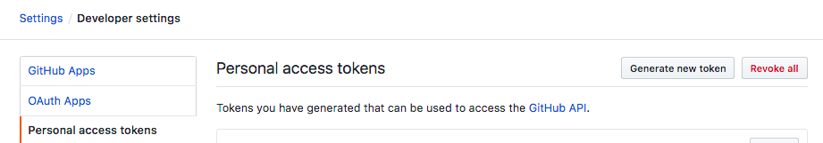
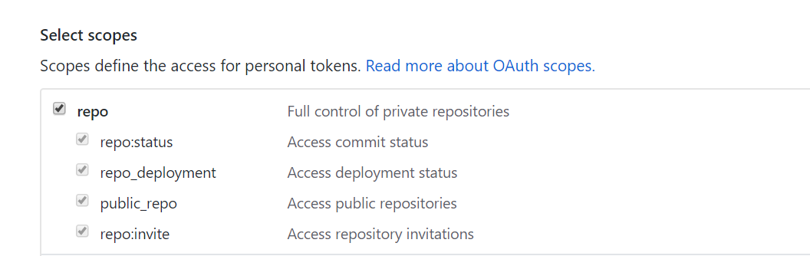
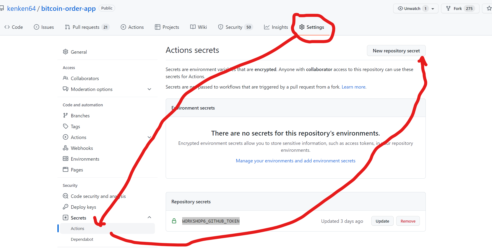
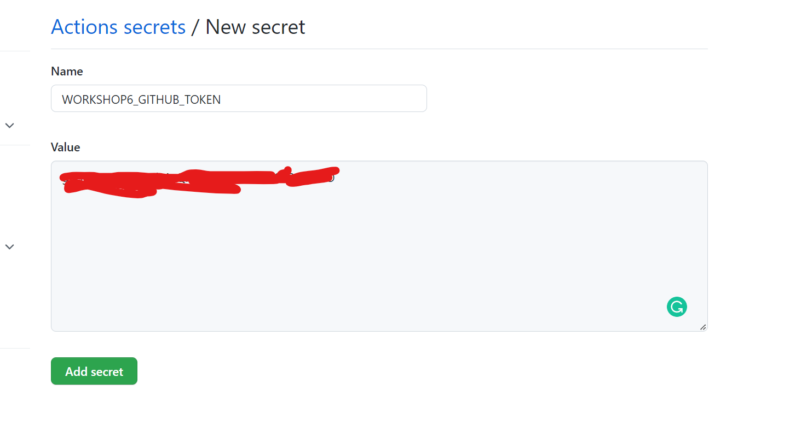
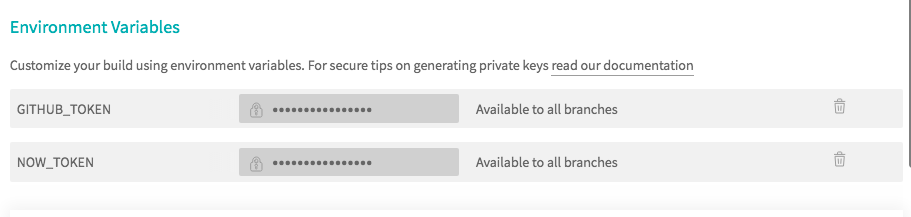
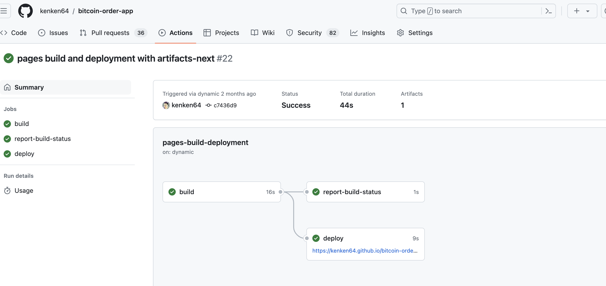

# S-DOEA - Workshop 6 - DevOps in the Cloud

## Objective

The objective of this workshops is to learn how to setup and deploy frontend app using Github with Github Actions

## Pre-requisite

- Github Account

## Workshop

In this workshop you will setup a CD/CI to automatically build and publish your Frontend application to Github Pages using Github Actions.

1. Fork the source codes from the following URL https://github.com/kenken64/bitcoin-order-app to your own Github account. (Uncheck fork only main branch)

```
$ git clone https://github.com/<replace this with your github userid>/bitcoin-order-app
```

2. Checkout the githubcicd branch

```
 $ git checkout githubcicd
```

3. Generate a personal access token (classic) on GitHub with the `repo` and `workflow` scopes. The token must belong to an account with write access to your fork. Copy it for the repository secret in Step 4; do not commit the token to the repository.


   
   <br>
   

   
4. Navigate to the bitcoin app repository on the Github platform

- Under **Settings > Secrets and variables > Actions > New repository secret**, create a secret named `WORKSHOP6_GITHUB_TOKEN` with the token from Step 3. Click **Add secret**.
  
  
  

5. Under the working directory of the bitcoin app create the following directory

```
.github/workflows/
```

6. Under the above newly created directory which is likely to be hidden on the windows explorer create a file as below, not on the linux or mac system.

```
.github/workflows/build.yml
```

7. Add the following code to `build.yml` in your cloned repository. Keep `${{ secrets.WORKSHOP6_GITHUB_TOKEN }}` and the `GITHUB_TOKEN` environment variable name exactly as shown; GitHub Actions reads the token from the repository secret. YAML is case sensitive and indentation sensitive.

The checkout step must also use `WORKSHOP6_GITHUB_TOKEN`. Checkout persists its credentials for later Git commands, including the changelog action's commit/tag push and the deployment push. Setting the token only on the changelog and release steps leaves checkout using the default `GITHUB_TOKEN`, which can cause `Permission denied to github-actions[bot]` and HTTP 403 errors when pushing. See the [checkout authentication documentation](https://github.com/actions/checkout/tree/v2#usage).

Features:

- Install all relevant dependencies
- Perform a build on the frontend
- Lint the frontend app (the test step is included but commented out)
- Create a changelog-based release when there are releasable changes
- Deploy to the cloud provider

```yaml
name: Bitcoin order App
on:
  push:
    branches:
      - githubcicd
jobs:
  ci:
    runs-on: ubuntu-latest

    strategy:
      matrix:
        node-version: [16.x]

    steps:
      - uses: actions/checkout@v2
        with:
          token: ${{ secrets.WORKSHOP6_GITHUB_TOKEN }}
      - uses: browser-actions/setup-chrome@latest
      - name: Use Node.js ${{ matrix.node-version }}
        uses: actions/setup-node@v1
        with:
          node-version: ${{ matrix.node-version }}

      - name: Cache node modules
        id: cache-nodemodules
        uses: actions/cache@v3
        env:
          cache-name: cache-node-modules
        with:
          # caching node_modules
          path: node_modules
          key: ${{ runner.os }}-build-${{ env.cache-name }}-${{ hashFiles('**/package-lock.json') }}
          restore-keys: |
            ${{ runner.os }}-build-${{ env.cache-name }}-
            ${{ runner.os }}-build-
            ${{ runner.os }}-
      - name: Install Dependencies
        if: steps.cache-nodemodules.outputs.cache-hit != 'true'
        run: |
          npm ci --force
      - name: Build
        run: |
          npm run build --force
      - name: Lint
        run: |
          npm run lint
      - name: Update types to latest
        run: |
          npm install --save-dev @types/node@latest --force
      #- name: Test
      #  run: |
      #    npm run test --watch=false --browsers=ChromeHeadless
      - name: Conventional Changelog Action
        id: changelog
        uses: TriPSs/conventional-changelog-action@v3
        with:
          github-token: ${{ secrets.WORKSHOP6_GITHUB_TOKEN }}
          output-file: "false"

      - name: Create Release
        uses: actions/create-release@v1
        if: ${{ steps.changelog.outputs.skipped == 'false' }}
        env:
          GITHUB_TOKEN: ${{ secrets.WORKSHOP6_GITHUB_TOKEN }}
        with:
          tag_name: ${{ steps.changelog.outputs.tag }}
          release_name: ${{ steps.changelog.outputs.tag }}
          body: ${{ steps.changelog.outputs.clean_changelog }}
      - name: Deploy
        run: |
          npm run deploy

```

8. Github actions should build wherever there is a push to the development branch (githubcicd)

```
$ git add .
$ git commit -m "add github actions"
$ git push origin githubcicd
```
9. After a successful build, the application should be published to
    GitHub pages



## Bonus - Workshop

Only attempt this if you have completed the above workshop.

- Tag the repo with the below command and push the changes 

```
git push origin <tag name>
```

- Delete the feature branch when you have successfully published the
  front end application. Replace both of the placeholder `<remote name>` and `<branch_name>`

```
- name: delete branch
  run: |
    git push <remote_name> :<branch_name>
```

- Perform static code analysis with modification of the rules

```
- name: lint
  run: |
    ng lint
```

- Perform vulnerability scanning on Angular libraries

```
- name: Audit 
  run: |
    npm audit fix

```

- Dockerized the app and push the docker image to dockerhub OR AWS private docker registry

- Deploy the app to AWS's ElasticBeanStalk Docker v1
